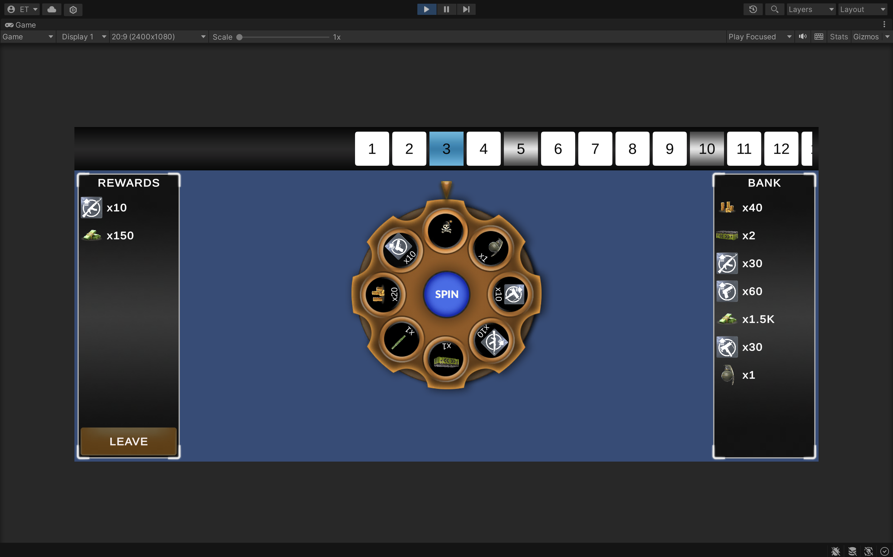
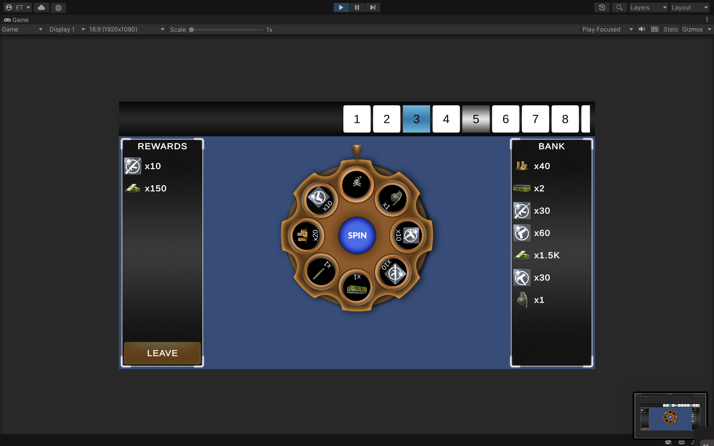
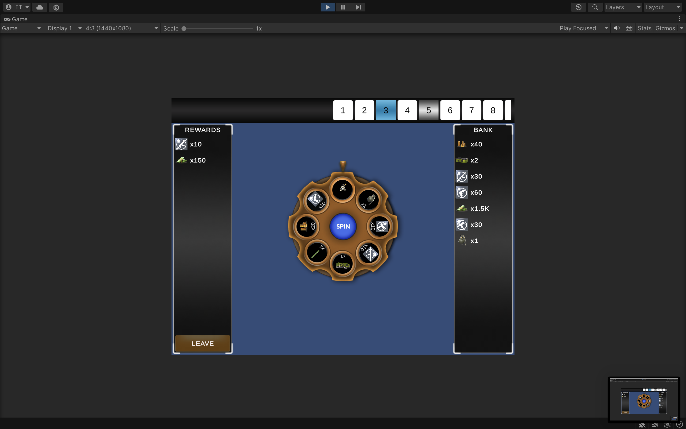

# Vertigo Wheel – Wheel of Fortune Demo

A wheel of fortune game made for the Vertigo Games developer demo. Spin the wheel to collect rewards zone by zone. A bomb on regular zones ends the run and takes everything collected so far. Every 5th zone is a safe silver spin and every 30th zone is a golden spin with special rewards; on these zones you can leave and keep your rewards in a persistent bank.

## Requirements
- Unity **2021.3.45f1** (LTS)
- Android Build Support module (only for building the APK)

## Setup & Run
1. Clone the repository.
2. In Unity Hub, choose **Add → Add project from disk** and select the cloned folder.
3. Open the scene **`Assets/Scenes/Game.unity`**.
4. Press **Play**. Recommended Game view resolutions: 2400×1080 (20:9), 1920×1080 (16:9), 1440×1080 (4:3).

The bank is stored in PlayerPrefs. To reset it, use **Edit → Clear All PlayerPrefs**.

## Download
The Android APK is attached to the latest entry under [Releases](../../releases).

## Running the Tests
**Window → General → Test Runner → EditMode → Run All.**
The EditMode tests cover zone type resolution, wheel building (single bomb, tiers, scaling), the run flow (reward, bomb, spinning, leaving) and the wallet.

## Gameplay Rules
- Each regular zone has exactly one bomb, placed on a random slice when the zone starts.
- Safe zones (every 5th) and super zones (every 30th) have no bomb.
- Leaving is allowed only when the wheel is not spinning and the current zone allows it (safe and super zones).
- Landing on a bomb ends the run immediately: collected rewards are lost and neither spinning nor leaving is possible.
- Leaving moves the run rewards into the bank, which persists between sessions.
- Later zones use wheels with more valuable rewards. Stackable rewards (currency, points, consumables) also grow with the zone; single items (weapons, cosmetics, chests) do not.

## Architecture
The code is split into assemblies. Each layer can only reference the layers listed next to it, and the compiler enforces this.

| Assembly | References | Responsibility |
|---|---|---|
| `VertigoWheel.Data` | – | ScriptableObject configuration: `RewardData`, `WheelConfig`, `ZoneTypeData`, `ZoneSettings`, `RewardCatalog` |
| `VertigoWheel.Core` | Data | Game rules as plain C# classes and the event bus |
| `VertigoWheel.Infrastructure` | Core | Unity-specific implementations: `UnityRandomProvider`, `PlayerPrefsWalletStorage` |
| `VertigoWheel.Views` | Core, Data | UI only, no game rules |
| `VertigoWheel.Controllers` | all | `GameController`, the composition root that creates and connects everything |
| `VertigoWheel.Tests` | Core, Data | EditMode tests |

**Core** contains no MonoBehaviours and makes no direct Unity API calls. It reads its configuration from the ScriptableObjects in the Data layer, so it depends on Unity types through that layer.

Key classes:
- **`GameSession`** owns the run and its state machine (`Idle`, `Spinning`, `Dead`, `Left`). Every spin and leave decision is made here; the views hold no game state.
- **`WheelBuilder`** builds the wheel for a zone: picks the wheel tier, validates the wheel at runtime, scales amounts and places the bomb.
- **`SpinResolver`** picks the landing slice. Randomness is injected through `IRandomProvider`, so tests can use fixed values.
- **`IWallet` / `Wallet`** keeps balances keyed by item id, so new currencies need no code changes. Persistence is behind `IWalletStorage`.
- **`EventBus`** is a type-safe `Subscribe<T>` / `Publish<T>` bus used for all communication between classes.

## Configuration
Everything is editable from the editor under `Assets/ScriptableObjects`:
- **Rewards:** icon, type, and whether the amount scales with the zone.
- **Wheels:** eight reward slices. Bombs are not part of the wheel data; they are added at runtime.
- **Zones:** each zone type defines its interval, priority, bomb and leave rules, zone bar sprite and wheel tiers. Adding a new zone type means creating a new asset and adding it to `ZoneSettings`; no code changes are needed.
- **RewardCatalog:** use **Collect All Rewards In Project** from its context menu after adding new rewards.

## Design Notes
- **Reward ids** are the asset names. Renaming a reward asset therefore detaches existing bank balances from it; a production version would use a stable GUID.
- **No `Resolved` state:** a reward advances the zone and returns to `Idle` immediately, so an extra intermediate state was not needed.

## Screenshots

